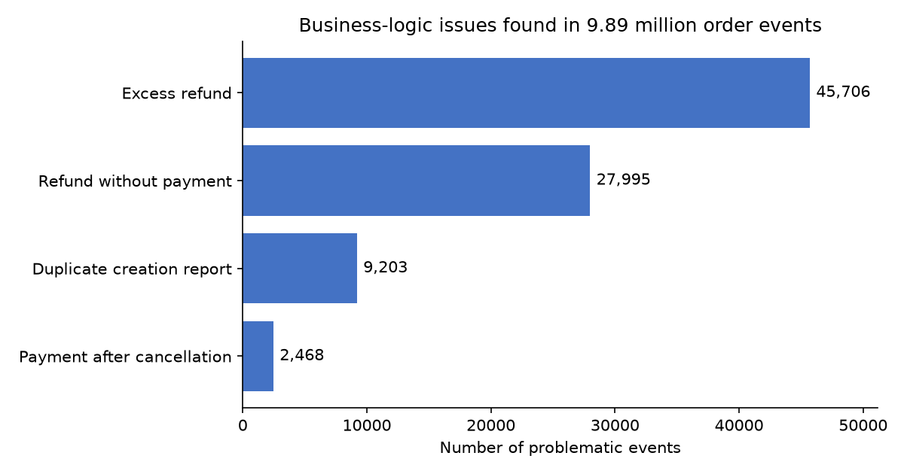
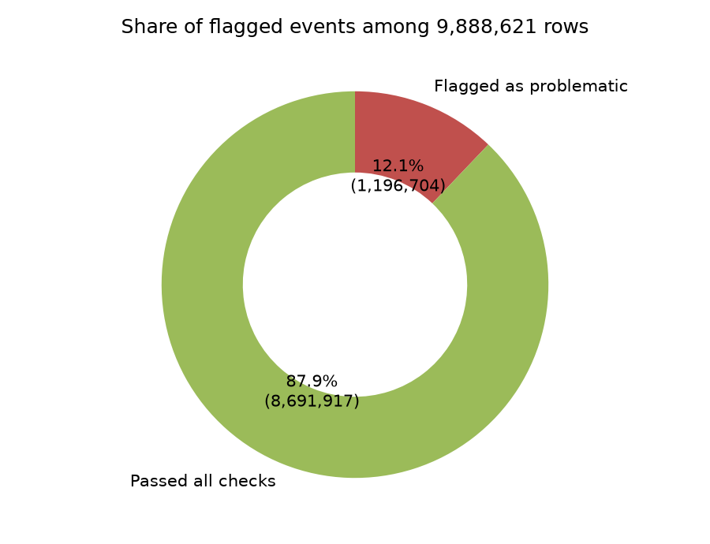

# Data Science Portfolio — Order Event Data Quality Analysis

Author: Wang Sixuan (mc664943) · Course: CISC7204 · Project 01

## Overview

This project audits an **order-event log of 9,888,621 events** (8 CSV files, 18 columns,
about 1 GB in total) for data-quality problems: event-ID and amount format errors,
missing required fields, duplicate transaction reports, impossible timestamps, invalid
category values, and four business-logic rules (excess refunds, refunds without a
matching payment, duplicate order-creation reports, and payments after cancellation).

The audit script reads the CSV files in **50,000-row chunks**, so peak memory stays low
even though the full log is far larger than RAM would comfortably allow. Every detected
problem is recorded by its **original event ID**, and the IDs are exported to
`problematic_event_ids.txt`.

## Repository contents

| File | Purpose |
|---|---|
| `project_01_template.py` | Main audit script (streaming/chunked analysis) |
| `make_figures.py` | Regenerates both figures from `results/summary.csv` |
| `results/summary.csv` | Aggregate audit results |
| `figures/` | The two visualizations shown below |

> The raw dataset (`Datasets.zip`, ~1 GB) is **not** included in this repository.
> See *How to reproduce* for how to obtain it and run the full audit.

## Findings

**1. Business-logic violations are dominated by refund problems.**
Among the four business-logic rules, excess refunds are the largest issue class
(45,706 events), followed by refunds issued without a matching successful payment
(27,995). Duplicate order-creation reports (9,203) and payments recorded after
cancellation (2,468) are comparatively rare.



**2. Roughly one in eight events fails at least one check.**
In total **1,196,704 unique events (12.1% of the log)** were flagged by at least one
format, missing-value, duplicate or business-logic check, while 87.9% passed all checks.



## How to reproduce

```bash
# 1. Install dependencies (Python 3.11+)
pip install -r requirements.txt

# 2. Run the audit on the full dataset
#    Download Datasets.zip from the course materials, place it next to
#    project_01_template.py, then:
python project_01_template.py        # writes problematic_event_ids.txt

# 3. Regenerate the figures
#    Uses results/summary.csv (shipped in this repo), so this step also
#    works without the 1 GB dataset.
python make_figures.py
```

`results/summary.csv` records the exact numbers behind the figures:

| metric | value |
|---|---|
| total_rows | 9,888,621 |
| excess_refund | 45,706 |
| refund_no_payment | 27,995 |
| dup_creation | 9,203 |
| pay_after_cancel | 2,468 |
| flagged_unique_events | 1,196,704 |

## Skills demonstrated

- Streaming/chunked analysis of a ~1 GB dataset with pandas
- Data-quality profiling: format, missing-value, duplicate and business-logic checks
- Aggregating results into a reproducible summary artefact
- Clear visual communication with matplotlib
